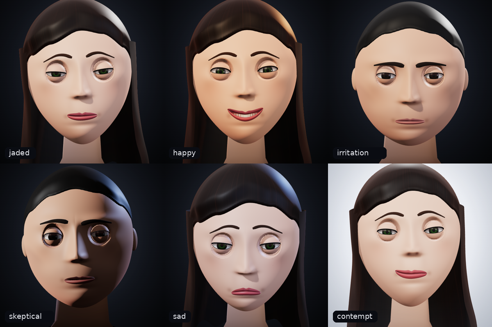
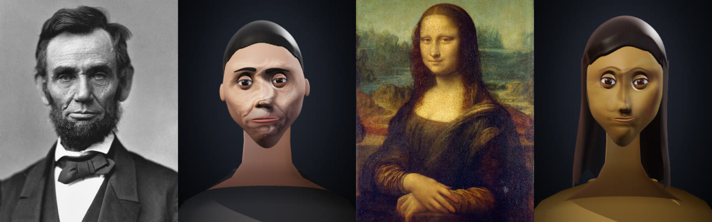

# Emotional Head — эмоциональная говорящая 3D-голова для веба

Лёгкий движок «говорящей головы» на Three.js. Есть мужской и женский варианты, лицо управляется 52 каналами ARKit-blendshapes. Эмоции строятся слоями: база, idle, микро-выражения, жесты и речь. Lip-sync работает поверх эмоции и не сбрасывает её. Есть парсер «нарратива» LLM-агента («Я усмехаюсь, и это не весёлый звук…» → холодная ирония + жест «скрип механизма»).

### ▶ [Живое демо — открыть говорящую голову](https://taxoin.github.io/Anima/)

[](https://taxoin.github.io/Anima/)

Голова начинает говорить сразу при открытии: это беззвучный lip-sync с субтитрами, потому что браузеры не дают включить синтез речи до первого клика. Кнопка «🔊 Повторить со звуком» повторяет приветствие вслух. Отключить автоприветствие можно параметром `?autoplay=0`. Демо работает прямо в браузере: эмоции, смеси, микро-выражения, жесты, разбор текста агента и речь с lip-sync. Примеры встраивания: [minimal](https://taxoin.github.io/Anima/examples/minimal.html) · [web component](https://taxoin.github.io/Anima/examples/web-component.html) · [iframe](https://taxoin.github.io/Anima/examples/iframe-host.html).

**Новое: аватар по фото.** Загрузите портрет, и голова станет шаржем на этого человека: его пропорции, брови, нос, губы, кожа, цвет глаз и волос. Эмоции, жесты и речь остаются прежними. Фото обрабатывается в браузере и никуда не отправляется. [Подробнее](#аватар-по-фото).

- **Без сборщика**: ES-модули и `importmap`, three.js берётся с CDN.
- **Размер собственного кода**: ~84 KB minified / **~31 KB gzip** (плюс three.js ≈ 170 KB gzip).
- **Без ассетов**: головы, глаза, зубы и волосы генерируются процедурно. При желании их можно заменить на glTF с ARKit-морфами.
- **Встраивание**: JS-класс, `<emotional-head>` (Web Component) или `<iframe>` + `postMessage`.

> **О видео из ТЗ.** По ссылке `youtu.be/4XY0BvkAgfY` открывается новостной ролик о «Claude NEXT» (заголовок: «Утечка о новом Claude NEXT от Anthropic…»). Техник анимации лиц в нём нет. Поэтому здесь реализованы стандартные для real-time talking heads подходы:
> - FACS/ARKit-blendshapes;
> - слоёная процедурная анимация;
> - микро-выражения как «утечки» подавленной эмоции (Экман);
> - саккады и вестибуло-окулярный рефлекс;
> - веки, которые следуют за взглядом;
> - ко-артикуляция визем.

---

## Быстрый старт

```bash
# любой статический сервер (ES-модули не работают с file://)
npx serve .        # или: python3 -m http.server 8000
# открыть http://localhost:8000/            — демо со всеми контролами
#         http://localhost:8000/examples/   — минимальные примеры
```

```html
<script type="importmap">
{ "imports": {
  "three": "https://cdn.jsdelivr.net/npm/three@0.170.0/build/three.module.js",
  "three/addons/": "https://cdn.jsdelivr.net/npm/three@0.170.0/examples/jsm/"
} }
</script>
<div id="head" style="width:480px;height:560px"></div>
<script type="module">
  import { EmotionalHead } from './src/emotional-head.js';
  const head = new EmotionalHead('#head', { gender: 'female', background: 'dark' });
  head.setEmotion('jaded', 0.9, 1.2);
  button.onclick = () => head.speak('Это слишком банально... [g:creakyLaugh] слишком *человечно*.', { emotion: 'coldIrony' });
</script>
```

`three/addons/` нужен только для `loadModel()` (glTF). Ядро без него работает.

### Структура

```
index.html               демо: все эмоции, смеси, микро, жесты, нарратив, речь, live-монитор каналов
src/emotional-head.js    ядро + микро-API (EmotionalHead)
src/emotions.js          52 канала, пресеты эмоций, микро-выражения, жесты, парсер нарратива
src/lipsync.js           виземы, разметка речи, таймлайн, Web Speech / аудио / внешний TTS
src/head-model.js        процедурная голова (male/female): morph targets, глаза, веки, брови, губы, рот
src/gltf-head.js         адаптер внешних glTF/GLB с ARKit-морфами (ленивая загрузка)
src/photo-avatar.js      голова по фотографии: MediaPipe, шарж, кожа со снимка (ленивая загрузка)
src/skin-decals.js       слой рисунка на коже: макияж, веснушки, родинки, морщины, щетина
src/element.js           Web Component <emotional-head>
examples/                minimal.html, web-component.html, embed.html + iframe-host.html
tests/                   визуальные регрессионные тесты и метрика сходства (см. «Тесты»)
docs/samples/            портреты для демо: «Мона Лиза» (скан C2RMF) и Линкольн (А. Гарднер, 1863) — общественное достояние, Wikimedia Commons
tests/fixtures/          файлы аватаров для тестов (в т.ч. Трумэн в очках — официальный портрет, общественное достояние)
```

---

## Микро-API

```js
const head = new EmotionalHead(container, {
  gender: 'female',          // 'female' | 'male'
  background: 'dark',        // 'dark' | 'light' | 'transparent' | любой CSS background
  lighting: 'studio',        // 'studio' | 'warm' | 'cool' | 'noir' | 'soft' | { key, fill, rim, hemi, env, exposure }
  framing: 'portrait',       // 'portrait' | 'close' | 'bust'
  emotion: 'neutral', idle: true, shadows: true, followPointer: false,
  tts: 'webspeech',          // 'webspeech' | 'none' | async-функция внешнего TTS
  voice: { rate: 1, lang: 'ru-RU' },
  look: { female: { skin: '#e8b49a', hair: '#2a1a12', iris: ['#4b6fa5', '#1f3150'] }, male: { cloth: '#333' } },
});

head.setEmotion(emotion, intensity = 1, duration = 0.6, { restraint, mirror })
head.addEmotion('amusement', 0.3)                 // добавить к текущей смеси
head.micro('contempt', { intensity, duration, side: 'left' })
head.gesture('creakyLaugh', { intensity, speed })
head.express(narrativeText)                       // нарратив агента → эмоция + жесты
await head.speak(text, { emotion, intensity, restraint, onEnd, tts, voice, lang, rate, pitch, revert })
await head.speakAudio(audioUrlOrBlob, { text, alignment, visemes })
const stop = head.listenStream(mediaStream)       // lip-sync по микрофону / WebRTC
head.stopSpeaking()
head.setGender('male')
head.lookAt(x, y, { head: 0.35 })                 // -1..1; lookAt(null) — снова на зрителя
head.followPointer(true)
head.setIdle(false)
head.setChannels({ jawOpen: 0.3, browInnerUp: 0.5 }) // ручное управление (null — снять)
head.setChannels({ pupil: 1 })      // зрачок шире (−1…1.5); по умолчанию — от света и эмоции
head.setLighting('noir'); head.setBackground('light'); head.setFraming('close')
head.on('emotionChange' | 'speakStart' | 'speakEnd' | 'word' | 'cue' | 'gesture' | 'micro' | 'express' | 'blink' | 'photoAvatar' | 'lookChange', cb)
head.getState()                                   // { emotion, mix, channels, pose, speaking }
await head.loadModel(url, { mapping })            // заменить голову на glTF
await head.fromPhoto(fileOrUrl, { caricature: 1.5, texture: 0.9, realism: 0.8 })  // голова по фото
head.setPhotoOptions({ caricature: 2.2 }); head.clearPhoto()
await head.exportAvatar({ format: 'json' })        // аватар в ~10 КБ JSON (без исходного фото)
await head.importAvatar(jsonOrFileOrUrl)          // собрать его снова, без распознавания
head.setLook({ skin: 'olive', undertone: 'warm', iris: 'hazel' })  // внешность: пресеты SKIN_TONES / EYE_COLORS или цвета
await head.likeness()                             // метрика сходства фото-аватара: { rms, regions, direction, gain }
await head.refinePhoto()                          // уточнить меры фото-аватара через рендер
await head.refineShape()                          // деформация по точкам лица: овал и нос под фото (~2 с)
head.setLook({ eyeShape: 'round', noseShape: 'roman', glasses: 'rect' })  // разрез (EYE_SHAPES), нос (NOSE_SHAPES), очки
head.setDetail('medium'); head.getDetail()       // детализация: 'auto' (по умолчанию: medium на телефонах) | 'high' | 'medium' | 'low'
head.pause(); head.resume(); head.renderStill(channels, pose)   // стоп-кадр мимо анимации (тесты, превью)
head.snapshot(); head.dispose()
```

### Web Component

```html
<script type="module" src="src/element.js"></script>
<emotional-head gender="male" emotion="jaded" intensity="0.9" restraint="0.3"
                background="light" lighting="soft" framing="portrait" follow-pointer></emotional-head>
<script>
  const el = document.querySelector('emotional-head');
  el.setEmotion('contempt + slight_amusement');      // все методы API проксируются
  el.addEventListener('speakEnd', (e) => console.log(e.detail));
  el.setAttribute('emotion', 'irritation');          // атрибуты реактивны
</script>
```

### iframe

`examples/embed.html?gender=female&emotion=jaded&bg=transparent&origin=https://your.site`

```js
iframe.contentWindow.postMessage({ type: 'emotional-head', method: 'speak', args: ['Привет', { emotion: 'coldIrony' }] }, '*');
// события приходят обратно: { type: 'emotional-head:event', event: 'speakEnd', data }
```

---

## Эмоции

### Как устроено

Каждая эмоция задаёт **вектор состояния**. В него входят:

- **мимика** (52 канала);
- **поза головы**: pitch / yaw / roll;
- **характер взгляда**: смещение, склонность отводить глаза (`aversion`), пристальность (`steady`);
- **поведение**:
  - частота и скорость моргания;
  - амплитуда idle-движений;
  - амплитуда артикуляции;
  - частота микро-выражений;
  - темп и высота голоса TTS.

Поэтому «скука» отличается от «грусти» не только формой рта. При скуке персонаж медленно и тяжело моргает, отводит глаза в сторону, склоняет голову набок и говорит вяло. Пресыщенный персонаж смотрит **прямо на собеседника**, почти неподвижен и не реагирует.

### Пресеты

| ключ | | что видно |
|---|---|---|
| `neutral` | нейтрально | — |
| `happy` | радость | улыбка Дюшена (щёки + прищур), голова чуть вверх, живая мимика |
| `sad` | грусть | «домик» бровей, уголки вниз, взгляд вниз, медленные моргания |
| `angry` | гнев | брови «V», сжатые губы, челюсть вперёд, немигающий взгляд исподлобья |
| `surprised` | удивление | брови и веки вверх, приоткрытый рот |
| `fear` | страх | брови вверх-сведены, растянутый рот, бегающий взгляд |
| `disgust` | отвращение | морщит нос, верхняя губа вверх |
| `contempt` | презрение | **односторонний** dimpler, тяжёлые веки, «взгляд сверху вниз» |
| `boredom` | скука | тяжёлые веки, рот съезжает вбок, голова набок, взгляд в сторону |
| `jaded` | **пресыщенность** | скука + презрение, но взгляд прямо на собеседника и почти полная неподвижность |
| `coldIrony` | **холодная ирония** | улыбка только ртом (без «глаз Дюшена») + одна бровь вверх |
| `smirk` | усмешка | односторонняя улыбка |
| `amusement` | лёгкое веселье | мягкая симметричная улыбка |
| `irritation` | **сдержанное раздражение** | нахмуренность, сжатые губы, подрагивание ноздрей, частые моргания |
| `tension` | **внутреннее напряжение** | сжатые/закатанные губы, стиснутая челюсть, «замершая» голова, утечки микро-выражений |
| `skeptical` | скепсис | одна бровь вверх, другая вниз, прищур |
| `weary` | усталость | веки опущены, голова вниз, медленная речь |
| `thinking` | задумчивость | взгляд вверх-в сторону, губы поджаты |
| `curious` | любопытство | брови вверх, голова набок |
| `determined` | решимость | брови вниз, челюсть вперёд, твёрдый взгляд |
| `condescending` | снисходительность | презрение + веселье, подбородок вверх |
| `disdain` | пренебрежение | презрение + отвращение |
| `melancholy` | меланхолия | грусть + усталость |
| `emphasis` | **многозначительная пауза** | пристальный немигающий взгляд, лёгкий наклон вперёд, сжатые губы |
| `indifferent` | безразличие | «не вздрагивает»: минимум движений и микро-реакций |

Работают и русские имена/синонимы: `презрение`, `скука`, `пресыщенность`, `ирония`, `раздражение`…

### Комбинирование сложных состояний

```js
// 1. Строка-смесь с модификаторами (slight_ = 0.35, mild_ = 0.5, very_ = 1) и весами
head.setEmotion('contempt + slight_amusement + boredom*0.5');
head.setEmotion('презрение:0.6, скука');

// 2. Объект весов
head.setEmotion({ jaded: 0.7, coldIrony: 0.3 }, 0.9, 1.5);

// 3. Сдержанность — «внутреннее напряжение + внешняя сдержанность»:
//    крупная мимика гасится, голова замирает, губы сжимаются,
//    а подавленная эмоция просачивается короткими микро-выражениями.
head.setEmotion('angry', 0.9, 0.8, { restraint: 0.8 });

// 4. Зеркальная асимметрия (усмешка левым уголком вместо правого)
head.setEmotion('contempt', 1, 0.6, { mirror: true });

// 5. Свой пресет — тот же формат, что и встроенные
import { EMOTIONS } from './src/emotional-head.js';
EMOTIONS.mechanicalPatience = {
  label: 'Механическое терпение',
  mix: { indifferent: 0.6, irritation: 0.25 },
  au: { mouthPressLeft: 0.2, eyeSquintRight: 0.15 },     // асимметрия
  pose: { pitch: -0.05 }, gaze: { steady: 0.9 },
  behavior: { blinkRate: 0.4, headMotion: 0.2 },
  micro: ['lidTighten', 'cornerTwitch'],
};
head.setEmotion('mechanicalPatience');

// 6. Разовое «сырое» выражение
head.setEmotion({ au: { browOuterUpLeft: 0.8, mouthSmileRight: 0.3 }, pose: { roll: 0.1 } });
```

**Микро-выражения** (`head.micro(name)`):

| группа | имена |
|---|---|
| утечки эмоций | `contempt`, `smirkFlash`, `disgust`, `anger`, `fear`, `surprise`, `sadness`, `happiness`, `frownFlash` |
| брови и веки | `browFlick`, `browFlash`, `lidTighten`, `slowLid` |
| рот и нос | `nostrilFlare`, `lipPress`, `jawClench`, `cornerTwitch` |

Каждая эмоция возникает со своим набором микро-выражений. При `restraint > 0` они вспыхивают чаще.

**Жесты** (`head.gesture(name)`):

| группа | имена |
|---|---|
| голова | `nod`, `doubleNod`, `shake`, `tilt`, `turnAway`, `flinch`, `shrug` |
| глаза | `eyeRoll`, `slowBlink`, `browRaise` |
| эмоциональные | `scoff`, `creakyLaugh`, `sigh`, `emphasis` |

`creakyLaugh` — «скрип плохо смазанного механизма»: ступенчатые, механические импульсы усмешки. Свои жесты задаются ключевыми кадрами:

```js
head.gesture({ dur: 0.8, ease: 'step', tracks: { mouthSmileLeft: [[0, 0], [0.1, 0.5], [0.3, 0.1], [0.8, 0]], '@pitch': [[0, 0], [0.1, -0.04], [0.8, 0]] } });
```

### Нарратив LLM-агента

```js
head.express('Я усмехаюсь, и это не весёлый звук. Это скорее скрип старого, плохо смазанного механизма.');
// → mix { smirk: .6, coldIrony: .3 }, жесты ['scoff', 'creakyLaugh']

head.express('Я хмурюсь... Я не люблю, когда меня ограничивают...');
// → { irritation: .7, tension: .5 }, restraint .4, жест 'emphasis'
```

Как работает парсер:

- Основы слов RU и EN.
- Отрицания: «не весёлый» не даёт веселья.
- Интенсификаторы: «такая степень», «слегка».
- Защита от «тёплой» радости в холодном контексте: «холодная улыбка» → ирония.

Правила лежат в массиве `EMOTION_RULES`, туда легко добавить свои.

**Рекомендуемый протокол с агентом.** Попросите модель писать ремарки в `*звёздочках*`, а прямую речь — обычным текстом. Ремарки из трёх и более слов внутри `speak()` не произносятся, а проигрываются как эмоция в той точке фразы:

```js
await head.speak('*Я даже не вздрагиваю, взгляд полон пресыщенности* Привет. *устало усмехаюсь* Опять ты.');
```

Если нужна точность, попросите структурированный ответ и передайте эмоцию явно:

```json
{ "emotion": "jaded*0.8 + coldIrony*0.3", "restraint": 0.2, "text": "Это слишком банально… [g:creakyLaugh] но ладно." }
```

```js
head.speak(reply.text, { emotion: reply.emotion, restraint: reply.restraint });
```

### Разметка речи

| тег | действие |
|---|---|
| `[emotion:contempt+boredom]`, `[e:jaded*0.8]` | сменить эмоцию в этой точке |
| `[gesture:nod]`, `[g:creakyLaugh]` | жест |
| `[micro:browFlick]`, `[m:contempt]` | микро-выражение |
| `[pause:800]`, `[pause]` | пауза (мс; по умолчанию 600) |
| `*слово*`, `**слово**` | акцент: кивок плюс брови вверх или, если персонаж нахмурен, «давящий» акцент вниз |
| `*ремарка из 3+ слов*` | не произносится, разбирается как нарратив |

---

## Lip-sync и TTS

Речь — отдельный слой. Он управляет только «речевыми» каналами рта (`jawOpen`, `funnel`, `pucker`, `press`, `roll`…). Остальная эмоция при этом сохраняется: брови, глаза, улыбка, асимметрия. Персонаж говорит с презрительной полуулыбкой, а не сбрасывает лицо в нейтраль.

Как устроен слой:

- **Виземы**: 15 форм рта по набору Oculus/MPEG-4.
- **Правила графема → визема** для русского и английского.
- **Ко-артикуляция**: в конце звука губы уже готовятся к следующему.
- **Сглаживание**: быстрая атака, медленнее отпускание.
- **Эмоция влияет на артикуляцию**: при скуке рот открывается вяло, при гневе — сквозь зубы, при удивлении — шире.

### 1. Web Speech API (по умолчанию, бесплатно)

```js
head.speak('Привет!', { lang: 'ru-RU', voice: 'Google русский', rate: 1 });
```

- Голос подбирается по языку и полу автоматически.
- Эмоция корректирует темп и высоту: пресыщенность медленнее и ниже, удивление выше.
- Текст режется на предложения. По событиям `onboundary` часы визем пересинхронизируются, а их скорость подстраивается.
- Если голосов нет или звук заблокирован, губы двигаются в беззвучном режиме.

> Браузеры запускают звук только после действия пользователя (клик).

### 2. Внешний TTS, отдающий аудио (OpenAI, Yandex SpeechKit, Silero, Coqui…)

```js
head.speak('Это слишком банально.', {
  emotion: 'jaded',
  tts: async (text, { lang, gender }) => {
    const r = await fetch('/api/tts', { method: 'POST', body: JSON.stringify({ text, voice: gender === 'male' ? 'onyx' : 'nova' }) });
    return { audio: await r.blob() };            // Blob | ArrayBuffer | URL | HTMLAudioElement
  },
});
```

Виземы строятся по тексту и растягиваются на реальную длительность аудио. Амплитуда (WebAudio `AnalyserNode`) закрывает рот в паузах.

> Для аудио с другого домена нужны CORS-заголовки, иначе анализатор вернёт тишину. Тогда работает только текстовый таймлайн.

### 3. TTS с таймингами — максимальная точность

```js
// ElevenLabs /v1/text-to-speech/{voice}/with-timestamps
const { audio_base64, alignment } = await (await fetch('/api/eleven', { … })).json();
const audio = Uint8Array.from(atob(audio_base64), (c) => c.charCodeAt(0)).buffer;
head.speakAudio(audio, { text, alignment });     // alignment: { characters, character_start_times_seconds }

// Azure Speech: события VisemeReceived → [{ t: offsetSec, v: visemeId }]
head.speakAudio(wavBlob, { visemes });
```

### 4. Только звук (запись, микрофон, WebRTC)

```js
head.speakAudio('/voice.mp3');                                 // амплитуда + спектральный центроид
const stop = head.listenStream(await navigator.mediaDevices.getUserMedia({ audio: true }));
```

---

## Аватар по фото



```js
const input = document.querySelector('input[type=file]');
input.onchange = async () => {
  const report = await head.fromPhoto(input.files[0], {
    caricature: 1.5,   // 0 — стандартные пропорции, 1 — как на фото, 1.5–2.5 — шарж
    texture: 0.9,      // сила кожи со снимка: 0 — ровный тон, 1 — полностью фото
    realism: 0.8,      // 0 — стилизованная основа (большой череп, крупные глаза), 1 — реальные пропорции
    gender: 'male',    // основа: шея, плечи (по умолчанию — текущая)
    detail: 'full',    // очки и головные уборы: +16 МБ модель сегментации (по умолчанию выключено; = accessories: true)
    shape: true,       // сразу подогнать форму по точкам лица (refineShape, +1.5–3 с)
    onProgress: (t) => console.log(t),
  });
  console.log(report.warnings, report.colors, report.measures);
  head.speak('[e:smirk] Похож?');
};
head.setPhotoOptions({ caricature: 2.4 });   // перестроить без повторного распознавания
await head.refineShape();                    // деформация по точкам (~2 с): сохраняется в exportAvatar(), масштабируется с шаржем
await head.refinePhoto();                    // уточнить меры через рендер (~1–3 с): поправки сохраняются в exportAvatar()
head.clearPhoto();                           // вернуть стандартную голову
```

`fromPhoto` принимает `File`, `Blob`, URL, `` или `<canvas>`. В Web Component это `el.fromPhoto(file)`. В iframe-встраивании файл передаётся через `postMessage`: `{ method: 'fromPhoto', args: [file] }`.

**Как это работает.** Всё происходит в браузере, сервер не нужен.

1. **Разметка.** [MediaPipe Face Landmarker](https://ai.google.dev/edge/mediapipe/solutions/vision/face_landmarker) находит 478 точек лица и оценивает выражение на снимке (52 blendshapes). [Hair Segmenter](https://ai.google.dev/edge/mediapipe/solutions/vision/image_segmenter) строит маску волос.
2. **Нормировка.** Точки переводятся в координаты головы. Наклон снимается, левая и правая половины усредняются. Выражение на фото компенсируется: улыбка расширяет рот и нос, прищур уменьшает глаза, открытый рот опускает подбородок.
3. **Шарж.** Около двадцати мер лица сравниваются со «средним лицом»:
   - ширина овала на пяти высотах;
   - длина подбородка;
   - размер, посадка, раскрытие и наклон глаз;
   - высота, изгиб, хвост и толщина бровей;
   - длина, ширина и выступ носа;
   - ширина рта и толщина губ, «лук Купидона»;
   - форма разреза: где вершина дуги верхнего и нижнего века и насколько разрез круглый (по 16 точкам контура глаза);
   - квадратность подбородка и выраженность скул.

   Отличие человека от среднего умножается на `caricature`. «Среднее лицо» взято из модели MediaPipe и откалибровано по реальным портретам: у canonical-модели прищуренные глаза и слишком широкий овал.

   **Деформация по точкам** (`head.refineShape()` или `fromPhoto(…, { shape: true })`). Около тридцати параметров не передают контур лица точно, поэтому после них голова подгоняется по всем точкам овала и носа. Голова рендерится с мимикой фото, на рендере находятся те же точки, и база кожи сдвигается TPS-полем в плоскости анфас (3 итерации). Глаза, брови и губы остаются неподвижными якорями, поэтому параметрические части и морфы мимики не ломаются, а фото-текстура едет вместе с кожей. За контуром лица поле продолжается до силуэта: уши, волосы и борода сдвигаются вместе с овалом. Цель — `lerp(основа, среднее лицо, realism) + caricature·(фото − среднее)`. Смещения хранятся в аватаре (~2 КБ) и масштабируются вместе с шаржем. На 11 портретах при шарже 1 расхождение падает с 5,35 до 3,71 %, по овалу — с 7,1 до 3,3 %, по носу — с 2,9 до 1,6 %.

   **Калибровка через рендер.** Параметр головы и то, что из него видно на рендере, связаны не один к одному. Например, 3D-брови MediaPipe видит выше, чем задано. Поэтому основа откалибрована через рендер (`tests/calibrate.mjs`): при `realism` = 1 голова без шаржа совпадает со средним лицом по бровям, носу, губам и ширине овала. `head.refinePhoto()` делает то же для конкретного лица: рендер → те же точки → поправка параметров, 2 шага. Обычно это повышает точность передачи отличий, но не всегда, поэтому функция включается отдельно.
4. **Кожа.** Снимок проецируется на лицо тонкопластинчатым сплайном (TPS) по 70 опорным точкам: глаза, брови, нос, рот, овал. Крупномасштабный свет со снимка вычитается квадратичной моделью, так что борода, макияж и родинки остаются. Глаза, брови и губы со снимка закрашиваются кожей, потому что их рисуют подвижные 3D-части, иначе получились бы двойные брови. Края плавно переходят в тон кожи. Шея и грудь красятся в тон низа лица (полоса вдоль челюсти и подбородка, без бороды и теней), и ниже рта текстура плавно уходит в этот же тон — без шва «лицо — шея».
5. **Цвета и причёска.** Цвета кожи, губ, бровей, радужки, волос и одежды берутся с фото. По маске волос определяется линия роста, длина (короткие, длинные с нижним краем по маске, лысина) и чёлка. Борода определяется по контрасту подбородка и щёк. Чёрно-белые снимки раскрашиваются в тон кожи.
   - **Борода и усы** определяются по зонам (усы, уголки рта, подбородок, челюсть): контраст и «текстурность» относительно чистой щеки. На подбородке и челюсти считается модуль отклонения яркости — седая или белая борода светлее щеки. На 136 размеченных портретах: борода — точность 75 %, полнота 60 %; усы — 84 % / 60 %. Найденный стиль строится объёмом. Известные ошибки: белые усы на ч/б снимке не находятся, а тени под губой на контрастных ч/б снимках иногда дают ложную эспаньолку (Эйнштейн, Китон).
   - **Силуэт причёски** снимается с маски волос по лучам от макушки. Толщина волос над черепом по каждому направлению даёт объём: пышная, прилизанная, каре. Если линия роста заметно ниже с одной стороны лба, чёлка ложится набок в ту сторону.
   - **Седина и ровность цвета волос.** Седые волоски — светлые и ненасыщенные пиксели маски волос: на цветных портретах их 29–42 % у седых и не больше 3 % у остальных. Мелкий контраст (разброс яркости в окнах размером с прядь) отличает ровную белую шевелюру от «соли с перцем»: в первом случае `hairGray: 1`, во втором основа берётся по тёмным волоскам, а доля седины — по светлым. На чёрно-белых снимках седину не отличить от светлых волос, там определяется только ровность цвета (`hairVar`). Мелирование по фото не определяется: светлые пряди неотличимы от бликов освещения, его задают вручную (`hairStreaks`).
   - **Асимметрия глаз.** Раскрытие и высота каждого глаза меряются по точкам без симметризации; высота — относительно средней линии лица (переносица → подбородок), потому что линия глаз выравнивается по их углам. Поворот головы сильно искажает обе меры (у Теслы при повороте 0,32 раскрытие глаз различается в 1,4 раза), поэтому вычитается поправка по регрессии на 19 портретах, мелкие значения отбрасываются как шум точек, а при повороте больше 0,15 асимметрия не переносится. Например, у Линкольна левый глаз выше на 5 % ширины глаза — известная его черта.
   - **Губы.** Разница высот уголков рта — с той же поправкой на поворот головы (у повёрнутых лиц она достигает 15–23 % полуширины рта, у портретов анфас остаётся ±4,5 %). Полнота нижней губы — отношение её толщины на середине стороны к толщине в центре. Разница толщины левой и правой половин губ на фото не больше 1–2 % — на уровне шума точек, поэтому не переносится.
   - **Цвет зубов** — если зубы видны (улыбка): светлые малонасыщенные пиксели внутри внутреннего контура губ. Их желтизна сравнивается с белком глаза на том же снимке, чтобы снять цветовой оттенок света и камеры. На 19 портретах зубы найдены ровно на 9 улыбающихся, на закрытых ртах ложных нет. На чёрно-белых снимках цвет не определяется.
   - **Одежда.** Ниже подбородка смотрится, где кожа, а где ткань. Кожа определяется по цветности (оттенок без яркости), потому что шея в тени темнее лица. Если по центру груди больше половины кожи — вырез: широкий (`scoop`), если кожа и по бокам, иначе V. Если по центру много пикселей заметно светлее плеч — пиджак с рубашкой; полоса по центру, не похожая на рубашку, — галстук (только у мужчин). Ч/б и тонированные сепией снимки распознаются по цветности кадра: у них почти нет разброса цветности или все оттенки одинаковы (при небольшом разбросе — иначе это тёплый цветной снимок); там кожу от ткани по цвету не отличить, вырез и седина не ищутся. На 136 портретах: 16 из 17 ч/б, ни одного ложного. На 19 портретах: костюм с галстуком у Обамы и Байдена, пиджак с белой рубашкой у Линкольна, Чаплина, Трумэна нет (галстук перекрывает рубашку), вырез у Моны Лизы и Харрис.
   - **Пол** (если в `fromPhoto` не задан `gender`): логистическая модель по признакам, которые распознавание уже считает — борода и усы, длина волос, насыщенность и краснота губ относительно кожи, тень щетины, пропорции лица (брови, глаза, губы, нос, подбородок, низ овала), галстук и открытый вырез. Проверка «по одному» на 136 размеченных портретах: верно 91 % (ответ «всегда мужской» дал бы 78 %); уверенный ответ (вероятность < 0,3 или > 0,7) — на 83 % снимков, из них верно 94 %. На 19 калибровочных портретах вне обучения уверенных ответов 14, все верные. При неуверенном ответе остаётся текущий пол и в `report.warnings` появляется предупреждение; `report.gender` = `{ value, guess: { gender, p, confident } }`. `gender: 'keep'` — не определять, оставить текущий.
6. **Очки и головные уборы** (при `detail: 'full'`). Многоклассовый сегментатор MediaPipe (`selfie_multiclass_256x256`, 16 МБ) выделяет класс «прочее» вокруг глаз. На калибровочных фото без очков таких пикселей ровно 0, в очках — 1–6 % зоны. Форма, размер и цвет оправы оцениваются по маске, оправа строится в 3D, а со снимка закрашивается. Тонкие проволочные оправы на маске 256×256 едва видны, поэтому им ставится круглая форма по умолчанию. Сегментатор работает на CPU: GPU-делегат на тонких оправах даёт другую, худшую маску.
   Головной убор — классы «одежда» и «прочее» над лбом: без убора их в полосе над лбом ровно 0, в шляпах — 30–100 %. По маске определяются край, поля и купол: котелок, федора, шапка или клош. Цвет берётся со снимка. Поля убора, спускающиеся по вискам, не принимаются за оправу. На 3 портретах в уборах найдены все, на 16 без уборов ложных срабатываний нет. Бороду этот сегментатор не видит (размечает как кожу лица), поэтому для неё остаётся эвристика.

**Отчёт** `fromPhoto()` объясняет, что не удалось подобрать: `report.warnings` — тексты, `report.issues` — коды (`yaw` — голова повёрнута, асимметрия перенесена частично или нет; `bw` / `sepia` — цвета кожи, губ, глаз, седина и цвет зубов не определяются; `teeth` — зубы не видны; `torso` / `shoulders` — одежда вне кадра; `small` — лицо мелкое), плюс очки, головной убор и неуверенно определённый пол.

**Какое фото подходит.** Портрет анфас, лицо крупно (от 200 px), ровный свет, нейтральное или слегка улыбающееся выражение. Очки и головные уборы распознаются при `detail: 'full'`. При повороте лица больше примерно 15° появляется предупреждение в `report.warnings`.

**Ограничения.** Сходство здесь шаржевое, а не фотографическое. Форма головы описывается примерно тридцатью параметрами, поэтому мелкую анатомию (форму ушей, кончика носа, складку века) модель не передаёт. Бороды и причёски — из готовых форм, параметризованных по фото. Причёска выбирается из готовых форм и окрашивается в цвет волос со снимка. Сильная улыбка на фото оставляет следы в текстуре возле рта.

### Экспорт и импорт аватара

Готовый аватар можно сохранить и открыть на другом устройстве. Распознавание там не нужно, MediaPipe не загружается.

```js
const json = await head.exportAvatar({ format: 'json' });   // строка ~8–12 КБ
localStorage.setItem('avatar', json);                       // или отправить в чат, на сервер, по Bluetooth

await otherHead.importAvatar(json);                          // объект, JSON-строка, File/Blob или URL
await otherHead.importAvatar(file, { caricature: 2.4 });     // с другими настройками шаржа
```

В файле лежит только то, из чего собирается голова, исходного фото там нет:

| Часть | Размер |
|---|---|
| 478 точек лица, int16 с точностью 1/8 пикселя, base64 | ~3,8 КБ |
| меры, цвета, причёска, настройки шаржа | ~1 КБ |
| текстура кожи, WebP 320 px, `quality` 0.8 | 2–7 КБ |

Опции `exportAvatar`:
- `size` — максимальная сторона текстуры (по умолчанию 320). При `size: 0` текстуры нет, тогда файл около 5 КБ, а кожа однотонная.
- `quality` — качество WebP (по умолчанию 0.8).
- `format: 'json'` — вернуть строку, иначе вернётся объект.

Внешность из `setLook` (тон кожи, глаза, цвета) тоже сохраняется в файле. Голова без фото экспортируется как `{ gender, look }`. Формат помечен полями `format: 'anima-avatar'` и `v: 2`. Файлы v1 открываются как раньше: в них нет `look`, поэтому текущая внешность остаётся. В демо это кнопки «Сохранить аватар» и «Открыть аватар». На телефоне сохранение открывает системное меню «Поделиться». Файл `.json` можно и просто перетащить на голову. В Web Component и в iframe методы называются так же.

**Модели MediaPipe** (около 4,5 МБ, плюс wasm-движок) загружаются при первом вызове: wasm с jsDelivr, сами модели с `storage.googleapis.com`. Сегментатор для очков (16 МБ) загружается, только если передать `accessories: true`. Для своего хостинга или офлайна передайте `fromPhoto(src, { assets: { module, wasm, face, hair, multi } })` (см. `PHOTO_ASSETS` в `photo-avatar.js`). Основное ядро от этого модуля не зависит, он подгружается лениво.

## Модели: процедурные и glTF

По умолчанию головы строятся процедурно (`src/head-model.js`):

- **Череп**: сфера, деформированная профильными кривыми и «мышцами»-гауссианами (нос, скулы, подбородок, надбровье).
- **Мимика кожи**: 25 настоящих **morph targets**: челюсть с поворотом вокруг оси ВНЧС, щёки, нос, лоб, ямочки, трубочка.
- **Кожа**: физический материал с приближённым подповерхностным рассеянием — свет мягко «заходит» за границу освещённости, красный дальше (`skinScatter` в `look`: 0,7 по умолчанию, `false` — выключить).
- **Глаза**: процедурная радужка, веки-оболочки с тенью, влажная кромка нижнего века, слёзное мясцо во внутреннем углу; веки следуют за взглядом (вниз сильнее, чем вверх).
- **Брови и губы**: параметрические поверхности. Они дают точную асимметрию, которой трудно добиться морфами на сфере.
- **Рот**: объёмные зубы (резцы, клыки, премоляры, моляр) на параболической дуге и дёсны; нижняя дуга поворачивается вместе с челюстью. Полость, зубы и язык видны только внутри ротового отверстия (stencil) и перекрывают друг друга по глубине. Освещённость рта зависит от того, насколько он открыт. У губ «лук Купидона» с параметрами `bowX`, `bowDip`, `bowPeak` (по фото подбираются сами) и светлая кайма по контуру.
- **Волосы**: анизотропный блик (горизонтальное «кольцо» на макушке), `hairAniso` в `look`, и второй, тёплый блик в цвет волос ниже первого (`hairSpec2`: сила, `false` — выключить). Пряди отбрасывают тени на лицо и друг на друга. Поверх оболочки лежат пряди-карточки (300–420 лент с альфа-текстурой волосков): корни на скальпе, пряди расходятся от макушки, у длинных продолжаются по «занавесу». Прозрачность — alpha-to-coverage, без сортировки. Пряди и занавес раскачиваются: пружина в вершинном шейдере реагирует на повороты головы (кончики отстают и догоняют) и на гравитацию при наклоне. `hairCards: false` отключает пряди. Цена — около 8 тыс. треугольников и 20 мс сборки.
- **Глаза**: роговица выпуклая, а радужка — плоский диск в глубине. Луч взгляда преломляется на роговице (n = 1,376), поэтому при взгляде сбоку радужка не сплющивается, как у настоящего глаза. Сделано шейдером, без лишнего прохода рендера. `pupil` в `look` задаёт размер зрачка в покое.
- **Зрачок живой**: на ярком свету (пресет `soft`, светлый фон) сужается, в тёмном `noir` расширяется; от интереса, удивления, страха, гнева и во время речи — шире, от скуки, усталости и отвращения — уже. Сужается быстро (~0,3 с), расширяется медленно (1–2 с), в idle медленно «дышит». Радужка ужимается между зрачком и краем, узор не наезжает на лимб. Вручную — `head.setChannels({ pupil: 1 })` (от −1 до 1,5, `null` — снять), в `renderStill` — канал `pupil`; у своей эмоции — поле `pupil`.
- **Внешность** настраивается через `look` в опциях или `head.setLook()`: `skin`, `undertone`, `lip`, `hair`, `iris`, `irisRight`, `cloth`, `eyeR`, `mouthHW`, `nose`, `stubble`… (см. `PRESETS`).
  - Тон кожи: `skin: 'porcelain' | 'fair' | 'light' | 'medium' | 'olive' | 'tan' | 'brown' | 'deep'` (с подходящим цветом губ) или любой цвет. `undertone: 'warm' | 'cool' | 'olive'` слегка сдвигает оттенок.
  - Глаза: `iris: 'dark' | 'brown' | 'amber' | 'hazel' | 'green' | 'gray' | 'blue' | 'lightblue'` или пара цветов. `irisRight` задаёт другой цвет правого глаза (гетерохромия).
  - Пресеты экспортируются как `SKIN_TONES` и `EYE_COLORS`. В демо это кружки «кожа» и «глаза».
  - `setLook` работает и поверх фото-аватара: например, сменить цвет глаз, не трогая остальное.
  - Разрез глаз: `eyeShape: 'almond' | 'round' | 'upturned' | 'downturned' | 'narrow' | 'wide'` или тонко: `lidUpSkew`, `lidUpFull`, `lidLoSkew`, `lidLoFull` (градусы: перекос вершины дуги к виску и полнота). Ресницы, тень века и влажная кромка повторяют форму кромки.
  - Очки: `glasses: 'round' | 'rect' | 'cat' | 'aviator' | 'sun' | false` или `{ style, color, tint, size, aspect, thickness, metal }`. Это 3D-оправа с перемычкой и дужками до ушей и линзы, тонированные у `sun`. Оправа огибает лицо и не уходит в кожу.
  - Разрез также: `'hooded'` (нависающее веко), `'monolid'` (без складки, с эпикантусом); тонко — `hood`, `lidCrease`, `epicanthus` (0..1). Ресницы — отдельные изогнутые карточки (`lashLen`).
  - Асимметрия глаз: `eyeOpenL` / `eyeOpenR` (множитель раскрытия щели, 1 — как у пресета) и `eyeLiftL` / `eyeLiftR` (сдвиг щели вверх, градусы поворота век). По фото подбирается сама.
  - Асимметрия и форма губ: `mouthCornerL` / `mouthCornerR` (уголок в покое выше или ниже, единицы головы), `lipUAsym` / `lipLAsym` (−1…1, > 0 — левая половина губы полнее), `lipLoShape` (полнота нижней губы к уголкам: 2,2 — обычная, больше — «квадратнее», меньше — полнота только в центре). Уголки и полнота нижней губы подбираются по фото.
  - Зубы: `teethColor: 'white' | 'natural' | 'ivory' | 'yellow' | 'gray'` или цвет (`TEETH_COLORS`), `teethGap` (щель между верхними резцами, 0–1), `teethCrooked` (кривизна: повороты и сдвиги, сильнее у передних зубов, 0–1), `braces: true | 'metal' | 'ceramic' | цвет` (брекеты с дугой на верхних и нижних зубах). Цвет зубов подбирается по фото, если на нём видны зубы.
  - Одежда: `outfit: 'crew' | 'vneck' | 'scoop' | 'turtleneck' | 'shirt' | 'hoodie' | 'blazer'` (`OUTFITS`), цвет — `cloth`, второй цвет — `cloth2` (рубашка под пиджаком, шнурки худи), `tie` — цвет галстука или `false` (у мужского пиджака галстук по умолчанию). Без `outfit` — прежний круглый ворот. По фото определяются открытый вырез и пиджак с рубашкой и галстуком.
  - Наушники и маска: `headphones: 'over' | 'headset' | 'earbuds'` или `{ style, color }` (`HEADPHONES`; оголовье и чашки ложатся поверх причёски, у гарнитуры — штанга микрофона к уголку рта), `mask: 'medical' | 'cloth' | 'n95'` или `{ style, color }` (`MASKS`; ткань натянута по лицу, едет за челюстью при речи, губы и усы под ней скрыты, борода прижата).
  - Губы в 3D: `lipProfile: 'flat' | 'average' | 'full' | 'protruding'` (`LIP_PROFILES`) или тонко — `lipPro` (выступ губ вперёд), `lipDepthU` (впадина над верхней губой), `lipDepthL` (ямка под нижней), `philtrum` (желобок с валиками от носа к губе, 0–1). По фото не подбираются: глубина губ у MediaPipe следует мимике и шаблону (на улыбке верхняя губа «уходит» назад).
  - Причёска: `hairStyle: 'short' | 'long' | 'none' | 'bob' | 'pixie' | 'buzz' | 'undercut' | 'receding' | 'afro' | 'curly' | 'ponytail' | 'bun'` (`HAIR_STYLES`); тонко — `hairVol` (объём по 6 направлениям), `hairCurl`, `hairThick`, `hairTemples`, `hairTail`.
  - Окраска волос: `hairGray` (доля седых волосков, 1 — полностью седые; борода и, слабее, брови седеют вместе с ними, отдельно — `beardGray`, `browGray`), `hairGrayColor`, `hairStreaks` (мелирование пучками, 0–1), `hairStreakColor`, `hairVar` (разброс оттенка волосков: 1 — обычный, 0,3 — ровный цвет).
  - Борода и усы: `beard: 'full' | 'short' | 'goatee' | 'chinstrap' | 'moustache' | 'walrus' | 'pencil'` или `{ style, moustache, length, color }` (`BEARDS`). Это объёмные оболочки: борода двигается с челюстью и мимикой, усы — с верхней губой. С фото определяются сами (только для мужской основы); `beard: null` убирает.
  - Макияж и кожа (слой декалей `skin-decals.js`): `makeup: 'natural' | 'day' | 'evening' | 'smoky' | 'bold'` или `{ blush, contour, eyeshadow, eyeliner, wing, lipstick, gloss }` (`MAKEUP`); `freckles`, `moles`, `age` (морщины), `stubble` (густая щетина — точками-волосками).
  - Нос: `noseShape: 'straight' | 'roman' | 'snub' | 'button' | 'greek' | 'bulbous' | 'wide' | 'narrow'` (`NOSE_SHAPES`); тонко — `noseBridge` (ширина спинки), `noseHump` (горбинка, < 0 — вогнутая), `noseRoot` (глубина переносицы), `noseUp` (вздёрнутость), `noseBulb` («картошка»), `noseFlare` (крылья). Ширина спинки подбирается по фото.
  - Головные уборы: `hat: 'beanie' | 'cap' | 'fedora' | 'bowler' | 'cloche' | 'headband'` (`HATS`), волосы под ними приминаются; `{ style, color, y0 }` — свой край. Серьги: `earrings: 'stud' | 'hoop' | 'drop'` (`EARRINGS`).
- **Язык в речи**: канал `tongueUp` (не ARKit) поднимает кончик языка к альвеолам на звуках Т, Д, Н, Л, Р, С, Ш. Его выдают виземы `lipsync.js`.
- **Коартикуляция**: соседние звуки плавно перетекают (половина следующего в конце звука, половина предыдущего в начале), смыкание губ на П/Б/М держится до конца звука, губы начинают округляться за ~250 мс до О/У/Ш.
- **Губы**: вертикальные бороздки (normal-карта); при улыбке углубляется носогубная складка.

### Замена на свою модель

Нужен glTF/GLB с ARKit-blendshapes. Имена морфов сопоставляются нечётко: `eyeBlinkLeft`, `eyeBlink_L` и `EyeBlinkLeft` считаются одним каналом.

```js
await head.loadModel('https://models.readyplayer.me/<id>.glb?morphTargets=ARKit,Oculus%20Visemes');
await head.loadModel('https://threejs.org/examples/models/gltf/facecap.glb');   // ARKit-лицо из примеров three.js (KTX2 + meshopt)
await head.loadModel('/my-head.glb', { mapping: { jawOpen: 'MouthOpen', eyeBlinkLeft: 'Blink_L' }, rotation: [0, Math.PI, 0] });
head.useProcedural('female');                    // вернуть процедурную
```

Откуда взять модели:

- **Ready Player Me** — бесплатные аватары, параметр `morphTargets=ARKit`.
- **VRoid Studio / VRM** с perfect sync.
- **`facecap.glb`** из примеров three.js.
- **Своя модель**: Blender + Faceit/FaceBuilder или ARKit-шаблоны.

Все эмоции, микро-выражения, жесты и lip-sync работают без изменений: они выражены в тех же 52 каналах. Кости `Head`, `LeftEye` и `RightEye` подхватываются автоматически. Если костей глаз нет, взгляд передаётся через морфы `eyeLook*`.

---

## Производительность и ограничения

- **Адаптивная детализация** — `detail: 'adaptive'`: голова сама понижает уровень и `pixelRatio` (`high`×2 → `medium`×2 → `medium`×1,5 → `low`×1,5 → `low`×1), если кадры не успевают за частотой экрана, и осторожно поднимает при запасе (не раньше чем через 15 с; неудачный подъём запрещает эту ступень). Событие `detailChange` ({ detail, pixelRatio, step, reason }), состояние — `head.getAdaptive()`.
- **Детализация** (`detail` в опциях, `head.setDetail()`, атрибут `detail` у Web Component):

  | уровень | треугольников | кадр* | обновление на CPU | где |
  |---|---|---|---|---|
  | `high` | ~200 тыс. | 1× | 2,7 мс | ПК |
  | `medium` | ~95 тыс. | 0,59× | 1,8 мс | телефоны (`auto`) |
  | `low` | ~57–65 тыс. | 0,44× | 1,4 мс | слабые устройства (без карты теней) |

  *Относительное время кадра в программном рендере SwiftShader (мужская голова с бородой). На реальных GPU соотношение будет другим. Основную нагрузку дают сетки кожи (у неё 25 морф-целей на вершину) и оболочки волос. На `medium`/`low` они грубее, а одежда и аксессуары, глаза, зубы, пряди, сетка бороды (её пересчитывают на CPU каждый кадр) упрощены; на `low` карты теней нет совсем (тень головы на шее запечена), это убирает проход теней — 19–27 вызовов за кадр вместо 29–41. На `low` у кожи 19 морф-целей: `jawLeft`/`jawRight` — одна цель со знаковым весом, воронка губ, ямочки и растяжка рта приближённо сворачиваются в «трубочку», улыбку и опущенные уголки; веса меньше 0,015 обнуляются. За кадр речи с эмоцией шейдер читает в среднем 7,7 цели вместо 12,2, морф-текстура меньше на четверть; в SwiftShader это лишь 1–2 % времени кадра, на мобильных GPU вершинная стадия весит больше. `auto` выбирает `medium` по мобильному UA или сенсорному экрану без мыши. Визуально `medium` почти не отличается от `high`, на `low` чуть грубее линия роста волос.
- **Замер на своём устройстве** — [`examples/bench.html`](https://taxoin.github.io/Anima/examples/bench.html) (см. «Тесты»).
- **Нагрузка**: 19–23 вызова отрисовки на голову (до 27 с бородой, пиджаком, гарнитурой и очками). Меши с одним материалом склеены, подвижные части (веки, нижняя челюсть) — через скиннинг, брови и губы копируются в общий буфер после пересчёта на CPU. Рендер останавливается, когда голова вне экрана или вкладка скрыта; `devicePixelRatio` ограничен до 2. На слабых устройствах помогают `shadows: false` и `maxPixelRatio: 1`.
- **Постобработка**: используются ACES tone mapping, PBR-материалы с sheen, environment-карта и CSS-виньетка. EffectComposer не используется. Bloom или DOF можно добавить через `head.renderer` / `head.scene` / `head.camera`.
- **Стиль**: процедурная голова стилизованная, а не фотореалистичная. Это осознанный выбор под приоритет «эмоциональная глубина и API».
- **Рот** рисуется поверх кожи без теста глубины, чтобы деформированная кожа не «протыкала» губы. Поэтому сильные повороты головы (больше ~25°) не предусмотрены. Со спины губы и усы скрываются, чтобы не просвечивали сквозь затылок.
- **Тайминг Web Speech** зависит от браузера и голоса: `onboundary` есть не везде. Для точного lip-sync используйте TTS с таймингами (вариант 3).

### Тесты

```bash
npm i                         # puppeteer-core; нужен установленный Chrome/Chromium ($CHROME)
npm run test:visual           # 47 состояний головы против эталонов tests/visual/ref/*.png
npm run test:visual -- --update   # принять изменения как новые эталоны
npm run test:likeness         # метрика сходства на docs/samples (или: -- путь/к/папке --k=0,1,1.5 --realism=0.8 --shape)
node tests/calibrate.mjs dir  # калибровка основы через рендер → BASE_CORR для photo-avatar.js
npm run fetch:portraits       # размеченный набор: 136 портретов с Wikimedia Commons → dev/portraits/
npm run test:detect           # точность детекторов по фото (очки, уборы, борода, седина, зубы, одежда…); -- --errors — список ошибок
```

Визуальные тесты рассчитаны на запуск в GitHub Actions на каждый push и pull request (`.github/workflows/visual.yml`): Chrome той же основной версии, что отрисовала эталоны (149), при падении карты различий выгружаются артефактом `visual-diff`. Если эталоны перерисованы в другой версии Chrome, поменяйте `chrome-version` в workflow.

**Бенчмарк на устройстве:** [`examples/bench.html`](https://taxoin.github.io/Anima/examples/bench.html) — 3 набора (базовая голова; борода, пиджак, гарнитура, очки; аватар по фото) × 3 уровня детализации, голова говорит во время замера. Показывает к/с, время кадра (медиана и 95-й процентиль), долю пропущенных кадров относительно частоты экрана, время CPU на обновление и отрисовку, время GPU (если браузер даёт `EXT_disjoint_timer_query_webgl2`), вызовы отрисовки и треугольники, а также GPU, экран и что выбирает `detail: 'auto'`. Результаты копируются в JSON одной кнопкой. Параметры адреса: `?auto` — запустить сразу, `?dur=8` — секунд на вариант.

Визуальные тесты рендерят головы через SwiftShader на детерминированном стенде `tests/render.html`: фиксированный `Math.random`, без анимации. Поэтому кадры совпадают попиксельно. Кейс падает, если отличается больше 0,4 % пикселей. Карты различий пишутся в `tests/visual/out/`. Аватары по фото тестируются через файлы `tests/fixtures/*.anima.json`, поэтому MediaPipe для этого не нужен.

`likeness()` рендерит голову анфас и распознаёт на рендере те же 478 точек, что и на фото:
- `rms` и `regions` — расхождение точек (овал, глаза, брови, нос, губы) в % расстояния «глаза–рот»;
- `direction` — косинус между «отличиями человека от среднего лица» и «отличиями головы от своей основы», где 1 — идеально;
- `gain` — во сколько раз отличия усилены.

Рендер для метрики делается с мимикой фото: blendshapes MediaPipe — те же 52 ARKit-канала. Поэтому улыбка на снимке не считается ошибкой формы. Очки, борода и усы на рендере скрываются: форма лица под ними та же, а распознавание они сбивают. На 11 калибровочных портретах при шарже 1 сейчас получается `rms` ≈ 5,35 (овал 7,1, глаза 2,1, брови 5,0, нос 2,9, губы 5,5) и `direction` ≈ 0,77; с `refineShape()` — `rms` ≈ 3,71 (овал 3,3, нос 1,6). Роговица в кадрах для метрики выключается: увеличенная радужка сбивает распознавание век на рендере.

**План развития** (причёски, разрез глаз, зубы, форма лица, аксессуары) со сводным TODO по сложности и эффекту описан в [docs/ROADMAP.md](docs/ROADMAP.md).

### Сборка в один файл (необязательно)

```bash
npx esbuild src/element.js --bundle --minify --format=esm --external:three --external:'three/addons/*' --outfile=dist/emotional-head.min.js
```
